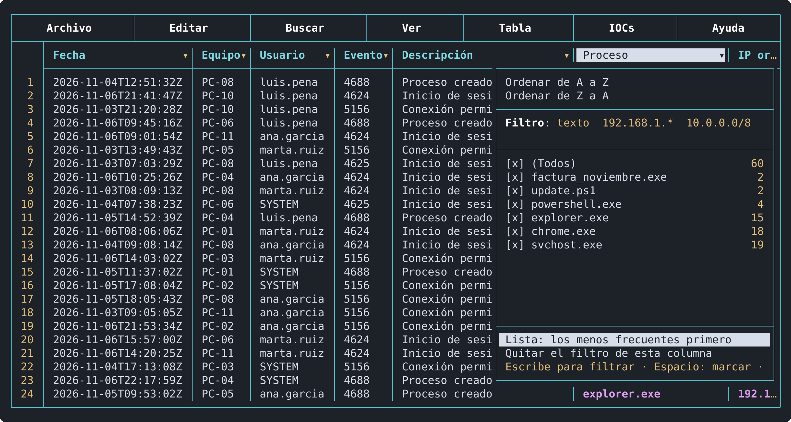
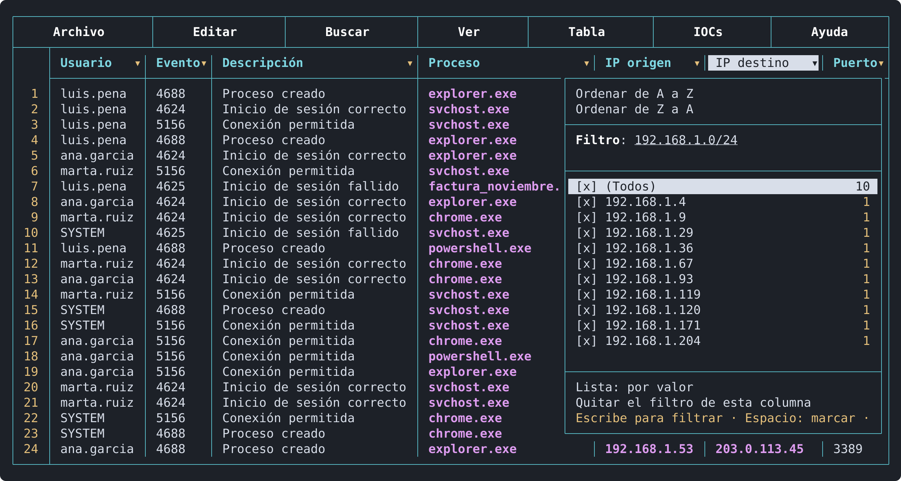
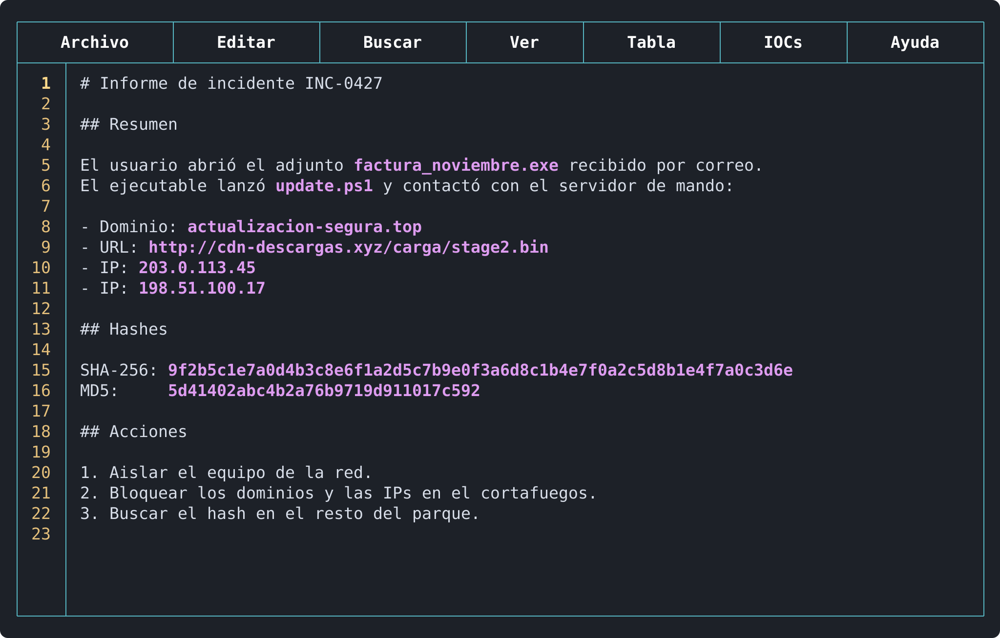

# isi

[Español](README.md)

Text editor for the terminal: fast, simple and in 23 languages.


The screenshots show the Spanish interface; isi starts in the language
of your system.

- Drop-down menus with the mouse or the Tab key, and keyboard shortcuts
  for everything.
- Line numbers that come and go with Ctrl+N.
- Markdown or box tables that realign themselves while you type.
- Opens CSV files as a spreadsheet: sort and filter by column like in
  Excel, count how many times each value appears, and understand IPs,
  network ranges and dates. Made for timelines and forensic tool output
  with hundreds of thousands of rows.
- Highlights and defangs IOCs (domains, IPs, URLs, executables and
  hashes): `evil.com` becomes `evil[.]com` with one key, or while you
  type.
- File encryption with XChaCha20-Poly1305 and Argon2id.
- In 23 languages. Starts in the system language or, if it is not
  available, in Spanish.
- Save as with a folder browser.
- Full UTF-8: ñ, accents, ¿¡, €, Chinese, emoji...
- A single static binary with no dependencies. Opens a file with a
  million lines in less than half a second.

## Install

Download the `.deb` for your machine from the
[releases](https://github.com/zil00g/isi/releases) page:

| Package | For |
|---|---|
| `isi_1.0.4_amd64.deb` | 64-bit PCs and laptops |
| `isi_1.0.4_i386.deb` | Old 32-bit PCs |
| `isi_1.0.4_arm64.deb` | Raspberry Pi 3, 4 and 5 with a 64-bit system |
| `isi_1.0.4_armhf.deb` | Raspberry Pi with 32-bit Raspberry Pi OS |

and, in the folder where you downloaded it:

```sh
sudo apt install ./isi_1.0.4_amd64.deb
```

`sudo dpkg -i isi_1.0.4_amd64.deb` works too.

Each release page lists the SHA-256 sums of every file. To check that
the one you downloaded is intact, also download `SHA256SUMS` and, in the
same folder:

```sh
sha256sum -c SHA256SUMS --ignore-missing
```

It is a static binary: it does not use the system libraries, so it does
not depend on their version. For other distributions there are
`.tar.gz` files with the bare binary.

To uninstall it: `sudo apt remove isi`.

### From source

You need a C compiler and `make`:

```sh
make
make check
sudo make install
```

`make check` tests IOCs, CSV, filters and encryption, and that files
encrypted with earlier versions still open.

`make estatico` builds it statically and `make deb` creates the package
in `dist/`. With musl (`CC=musl-gcc`) it is much smaller than with
glibc. `make MONOCYPHER=sistema` uses the Monocypher library installed
on the system (found with `pkg-config`) instead of the copy in
`monocypher/`.

The binary is built with stack protector, `_FORTIFY_SOURCE`, PIE and
full RELRO. When the package is installed, isi becomes an alternative
for `editor` (with low priority, so it does not replace the one you
have): `sudo update-alternatives --config editor` to choose it.

## Usage

```sh
isi file.txt
isi -r /etc/fstab    # read-only
isi +120 report.txt  # start at line 120
isi report.txt:120   # same thing, the way grep -n prints it
```


Ctrl+H (or F1) shows every shortcut and F10 opens the menus. The most
used ones:

| Key | Does |
|---|---|
| Ctrl+G / Ctrl+T | Save / save as |
| Ctrl+A | Open |
| Ctrl+Q | Quit |
| Ctrl+Z / Ctrl+Y | Undo / redo |
| Ctrl+X / C / V | Cut / copy / paste |
| Ctrl+E | Select all |
| Ctrl+F, F3 | Search, next |
| Ctrl+R | Replace |
| Ctrl+L | Go to line |
| Ctrl+N | Line numbers |
| Ctrl+D / Ctrl+B | Duplicate / delete line |
| Ctrl+K | Remove empty lines |
| Home / End | Start / end of the text |
| Alt+Home / Alt+End | Start / end of the line |

Messages appear in a row at the bottom that goes away by itself after a
minute, with a double click or with Esc.

If someone changes the file while you have it open, another program or
a coworker over SSH, isi asks you before overwriting it when you save.

### Searching with regular expressions

Ctrl+F and Ctrl+R take regular expressions too. Put them between
slashes, and they need at least one of these characters:
`[ ] ( ) * + ? { } | ^ $ \`. Case doesn't matter. Some examples:

```
/[0-9a-f]{64}/                    SHA-256 hashes
/([0-9]{1,3}\.){3}[0-9]{1,3}/     IPv4 addresses
/^2026-11-0[1-7]/                 lines from the first week
```

If there's none of those characters it's searched as is, like always.
So a path like `/tmp/` or `/home/ana/.config/` is searched and replaced
as plain text.

### Copy and paste

To paste into isi something copied elsewhere (a web page, a document,
another terminal) use **Ctrl+Shift+V**, the terminal's own paste. It
works on any Linux without installing anything. Plain Ctrl+V pastes the
last thing you copied inside isi.

When you copy with Ctrl+C, isi sends the text to the terminal (OSC 52),
so in kitty, foot, WezTerm, Alacritty, xterm, tmux and over SSH it
reaches the system clipboard without installing anything. If you also
have `wl-copy`, `xclip` or `xsel`, it uses them too.

Some terminals, such as GNOME Terminal, do not support OSC 52. There you
need `wl-clipboard` (or `xclip` on X11) to paste outside isi what you
copy with Ctrl+C:

```sh
sudo apt install wl-clipboard
```

## Tables

Table menu, Insert table. You choose the columns, the rows and the
style:


Tab and Shift+Tab jump between cells, and Enter goes to the first cell
of the next row, or creates it if you are on the last one. As you type,
the column grows and the rest of the table realigns. Rows and columns
are added and removed from the same menu.

## CSV

A `.csv` or `.tsv` file does not open as text: it opens as a sheet, with
aligned columns, the headers fixed at the top as you scroll down, and
columns that do not fit come into view as you move sideways. If the file
has another extension, File, Open CSV.


You edit cell by cell: just type. Tab and Shift+Tab move between cells,
Enter goes to the row below, and on the last row Enter or Tab create a
new one. Ctrl+D duplicates the row, Ctrl+B deletes it, and rows and
columns are added and removed from the Table menu. Ctrl+C copies the
cell.

When saving, the file stays exactly as it was except for what you
changed: same separator, same quotes, same line breaks (Windows ones
too), and the cells you do not touch do not change a single byte. If a
cell contains the separator, quotes or line breaks, isi adds the quotes
it needs.

### Sorting

Alt+↓ on any cell (or a click on the small arrow in the header) opens
the column menu. Sort A to Z or Z to A moves whole rows, Ctrl+Z undoes it
in one go, and it sorts according to what the column contains:

- Numbers as numbers: `9` before `10`, and `1.204,75 €` is a number.
- IPs by value: `10.0.0.9`, `10.0.0.10`, `10.0.0.100`.
- Dates in real order, even when mixed: `2026-11-03T10:15:22.123Z`,
  `2026-11-03 10:15` and `17/11/2026 09:00` sort together.
- Text in dictionary order: ignoring case and accents, with ñ after n.
- Empty cells always last.

### Filtering

The same menu lists every value of the column, each with the number of
times it appears, and check boxes to keep the ones you want (Space
checks and unchecks, Enter applies). The list can be sorted by value or
by frequency: with "List: least frequent first" the rare entries come to
the top, which is what you look for when stacking a timeline.



And if you type, the list is filtered as you type:



| You type | It keeps |
|---|---|
| `madr` | what contains "madr", ignoring case and accents |
| `Madr*` | what starts with Madr (Madrid, Madrileños) |
| `*rid` | what ends in rid |
| `Madri?` | Madri and one more character |
| `192.168.1.0/24` | the IPs in that network |
| `!10.0.0.0/8` | everything except that network |
| `>1000`, `<=50`, `=443` | comparisons with numbers, IPs or dates |
| `2026-03-01..2026-03-31` | a range, here the whole of March (last day included) |
| `>=2026-11-03` | from that day on |
| `svchost \| explorer` | one thing or the other |

Several columns can be filtered at once. Filtered columns show `▼` in
the header, the bottom row shows how many rows are left, and rows keep
their number, like in Excel. Table, Clear all filters, puts it back as
it was. Searching with Ctrl+F skips the hidden rows.


IOCs are highlighted inside cells too, and Ctrl+W defangs them in the
whole file.

### Convert to a table

File, Convert CSV to table. With a CSV open, it creates a new document
with the table in Markdown or box style, with what you are seeing: if
there is a filter, only those rows, and in the current order. With no
CSV open, it lets you choose the file and inserts the table at the
cursor; in that case it converts to UTF-8 the CSV files that Excel saves
in Latin-1.

### Large files

Tested with a timeline of 200,000 rows, 12 columns and 46 MB on an
ordinary laptop: it opens in less than a second, sorting by IP takes a
second and a half, and typing in a cell is as smooth as in a small file.

## IOCs

The IOCs menu is meant for people who work with incident reports or
malware samples:



- Highlights domains, IPs, URLs, executables (`.exe`, `.dll`, `.ps1`,
  `.vbs`, `.hta`, `.lnk`, `.scr`...) and MD5, SHA-1 and SHA-256 hashes,
  also inside code. It tells `evil.com` apart from `this.top` or
  `logger.info()`.
- Defang IOCs (Ctrl+W): `evil.com` → `evil[.]com`,
  `http://` → `hxxp://`, `1.2.3.4` → `1[.]2[.]3[.]4`. On the selection
  or on the whole text.

  

- Refang IOCs does the opposite and also understands `(.)` and `[dot]`.
- Defang while typing: each IOC is defanged as soon as you finish typing
  or pasting it.
- Copy IOC list: to the clipboard, without duplicates and defanged.

## Languages

Español, English (US), English (UK), 中文, हिन्दी, العربية, Français,
Português, Русский, Bahasa Indonesia, Deutsch, 日本語, Türkçe, Tiếng Việt,
한국어, Italiano, ไทย, Polski, Українська, Nederlands, Ελληνικά, עברית and
Hrvatski. It is changed in View, Language, and remembered in
`~/.config/isi/config`.

## Encryption

File, Encrypt. It asks for a password of at least 15 characters with
letters, numbers and some symbol, and asks for it twice.


From then on, every time you save, the file is saved encrypted. When
you open it with isi, it asks for the password.

If you forget it, there is no way to recover the file. Not me, not
anyone.

File format, in case you want to decrypt it with another tool:

| Bytes | Content |
|---|---|
| 0-3 | `ISI1` |
| 4-19 | Argon2id salt |
| 20-43 | XChaCha20 nonce |
| 44-59 | Poly1305 tag |
| 60- | Ciphertext |

The key comes from Argon2id with 64 MiB of memory, 3 passes and a single
lane. The first 44 bytes are used as associated data, so if someone
tampers with the header the file does not open. Every save uses a new
nonce.

[FORMAT.md](FORMAT.md) has more detail and a Python script to open
the file without isi. What it protects and what it doesn't, and how to
report a security bug, are in [SECURITY.md](SECURITY.md).

## License

GPL version 3 or later. See [LICENSE](LICENSE).

Encryption is [Monocypher](https://monocypher.org), by Loup Vaillant and
others, under the two-clause BSD license or CC0, included unmodified in
`monocypher/`.
