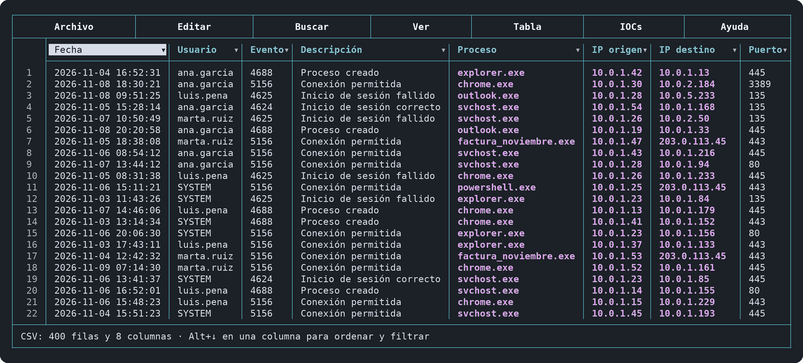
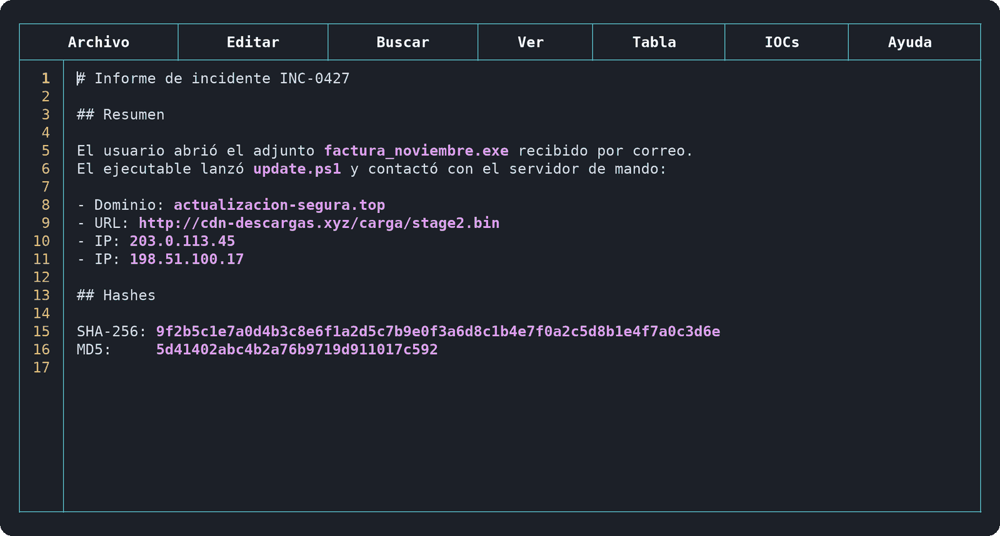
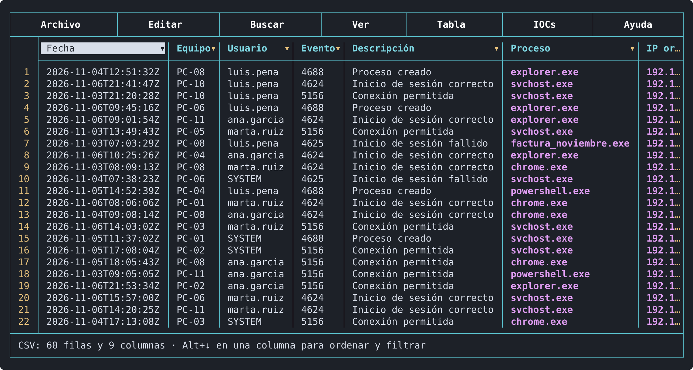
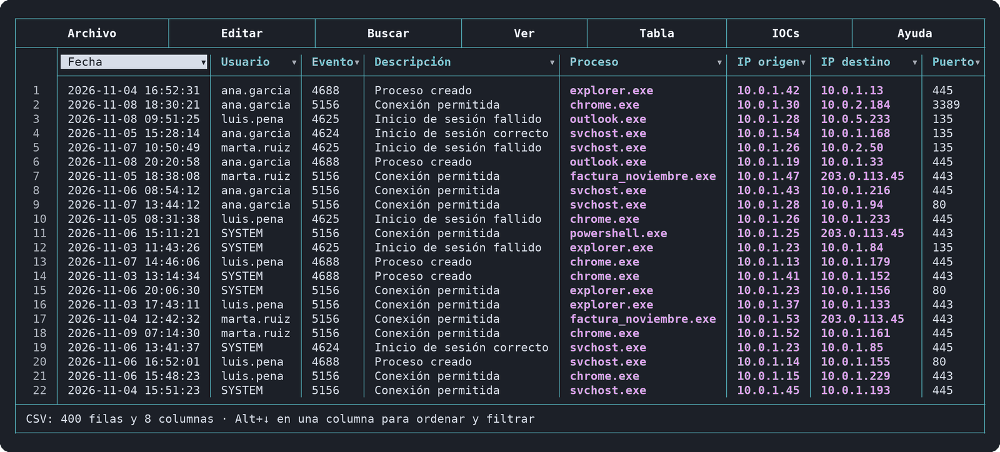
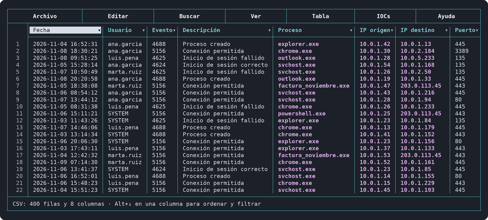
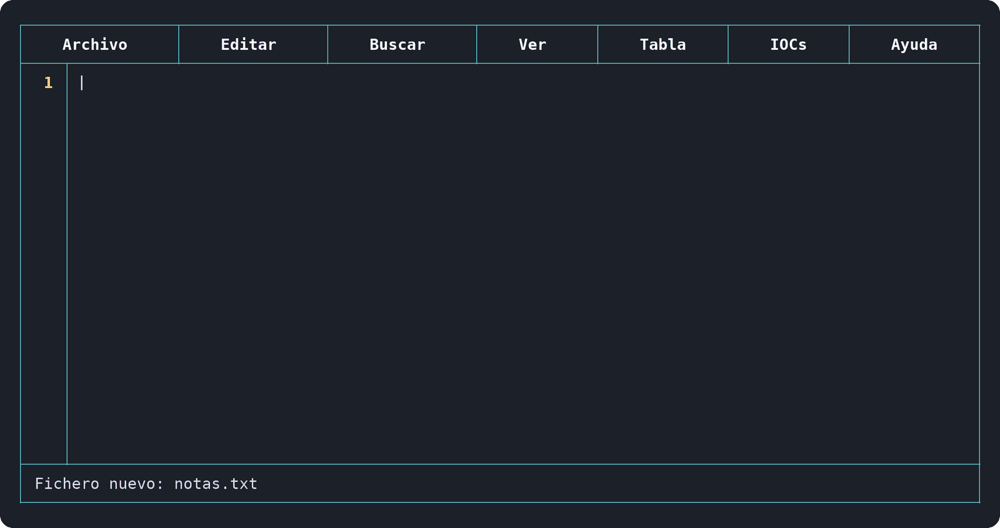
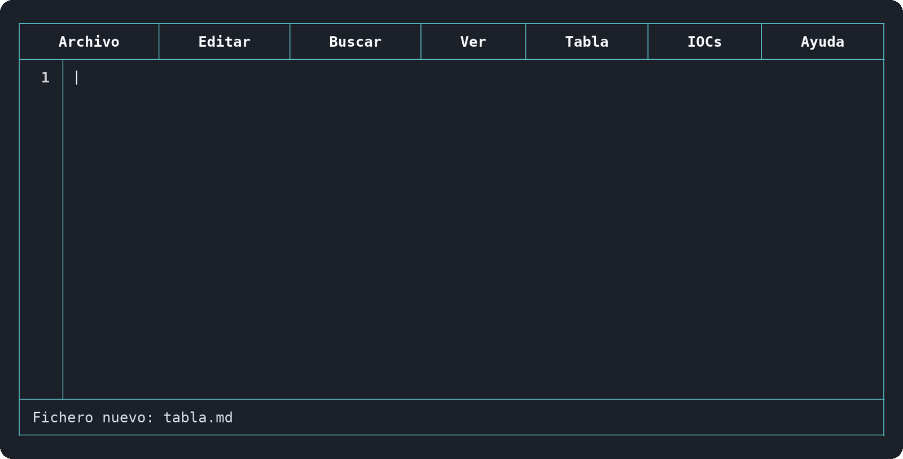
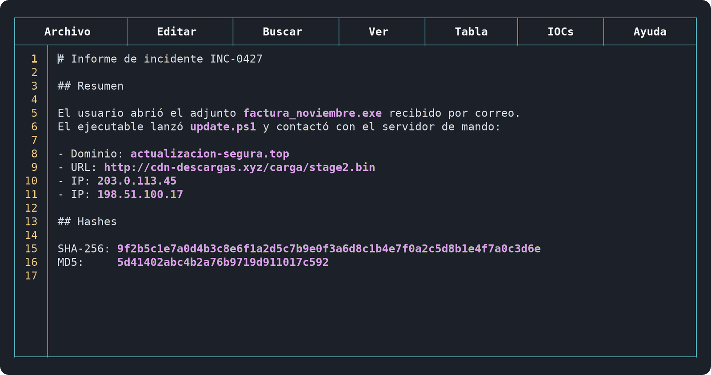
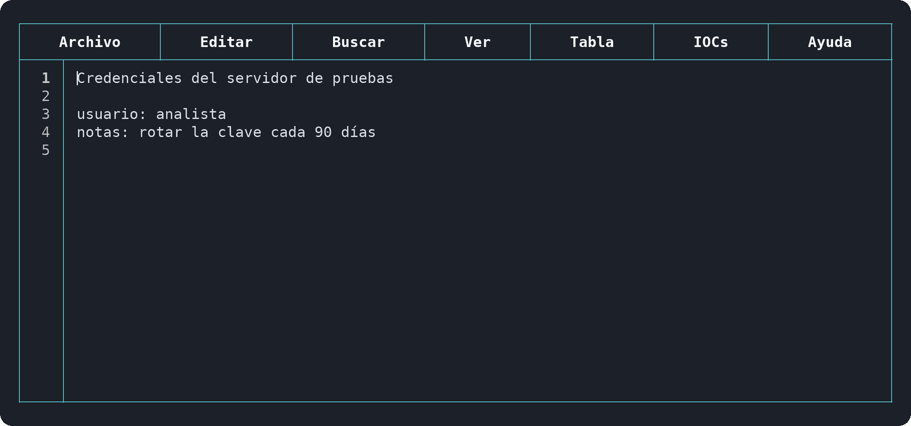
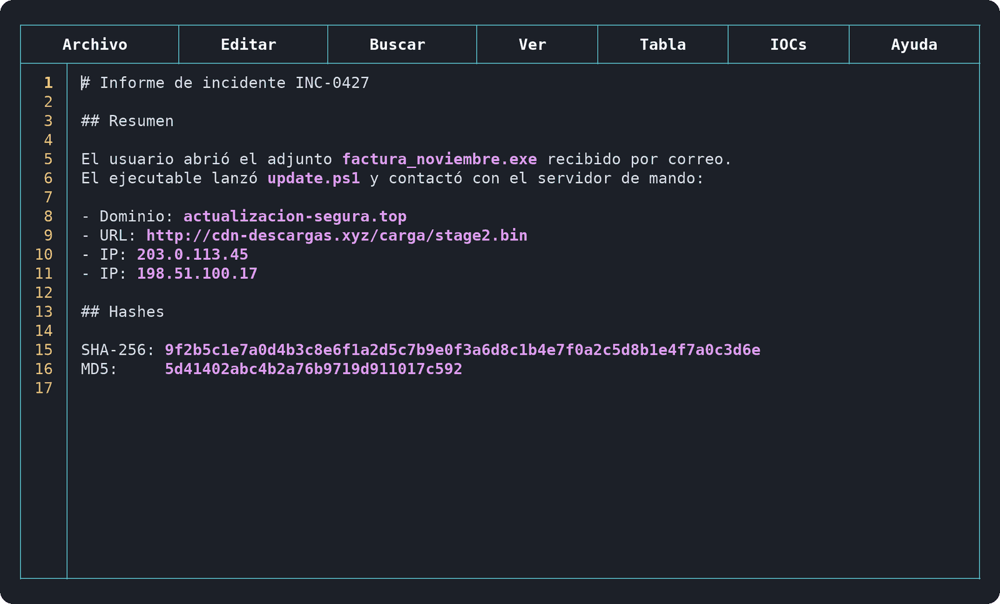

<div align="center">

# isi

[](https://github.com/zil00g/isi/actions/workflows/revisar.yml)
[](https://github.com/zil00g/isi/releases/latest)
[](LICENSE)

[Español](README.md)

</div>

A terminal text editor made for people who work in cybersecurity. It opens CSV files like a spreadsheet, defangs IOCs with one key and encrypts files. It is a single binary and needs nothing else.



The animations show the Spanish interface. isi starts in the language of your system.

The idea comes from daily work in a CSIRT. Reviewing a timeline or writing a report means jumping between an editor, a spreadsheet and small scripts to defang IOCs. isi puts all of that in one program that runs in any terminal.

Text files and CSV files are easy to handle, with keyboard shortcuts or from the menus, using the mouse or the Tab key.

It is written in C, and over a couple of years it turned into a fast tool meant to save time during the investigation phases of an incident and to handle different files quickly and simply. I kept adding the features I found useful, for example filtering a CSV with hundreds of thousands of rows before opening it in a spreadsheet, so the spreadsheet does not freeze.

## Contents

- [Install](#install)
- [Getting started](#getting-started)
- [Working with a CSV](#working-with-a-csv)
- [IOCs](#iocs)
- [Tables](#tables)
- [Search and replace](#search-and-replace)
- [Copy and paste](#copy-and-paste)
- [Encryption](#encryption)
- [Language](#language)
- [Building from source](#building-from-source)
- [Issues and improvements](#issues-and-improvements)
- [License](#license)

## Install

Download the `.deb` for your machine from the [releases](https://github.com/zil00g/isi/releases) page:

| Package | For |
|---|---|
| `isi_1.0.4_amd64.deb` | 64-bit PCs and laptops |
| `isi_1.0.4_i386.deb` | Old 32-bit PCs |
| `isi_1.0.4_arm64.deb` | Raspberry Pi 3, 4 and 5 with a 64-bit system |
| `isi_1.0.4_armhf.deb` | Raspberry Pi with 32-bit Raspberry Pi OS |

From the download folder run:

```sh
sudo apt install ./isi_1.0.4_amd64.deb
```

`sudo dpkg -i isi_1.0.4_amd64.deb` works too. To uninstall it use `sudo apt remove isi`.

Each release page lists the SHA-256 sums of every file. To check that the download is intact, also download `SHA256SUMS` and in the same folder run:

```sh
sha256sum -c SHA256SUMS --ignore-missing
```

It is a static binary. It does not use the system libraries, so it does not depend on their version. For other distributions there are `.tar.gz` files with the bare binary.

When the package is installed, isi becomes an alternative for `editor` with low priority, so it does not replace the one you already have. To choose it use `sudo update-alternatives --config editor`.

## Getting started

To open a file run from the terminal:

```sh
isi report.txt
isi -r /etc/fstab        # read-only
isi +120 report.txt      # open at line 120
isi report.txt:120       # same thing, the way grep -n prints it
```

Everything can be done with keyboard shortcuts or from the menus. F10 or the mouse open the File, Edit, Search, View, Table, IOCs and Help menus, and Ctrl+H or F1 show every shortcut.



These are the most used shortcuts:

| Key | Does |
|---|---|
| Ctrl+G / Ctrl+T | Save / save as |
| Ctrl+A | Open |
| Ctrl+Q | Quit |
| Ctrl+Z / Ctrl+Y | Undo / redo |
| Ctrl+X / C / V | Cut / copy / paste |
| Ctrl+E | Select all |
| Ctrl+F, F3 | Search, next |
| Ctrl+R | Replace |
| Ctrl+L | Go to line |
| Ctrl+N | Line numbers |
| Ctrl+D / Ctrl+B | Duplicate / delete line |
| Ctrl+K | Remove empty lines |
| Home / End | Start / end of the text |
| Alt+Home / Alt+End | Start / end of the line |

Save as opens a folder browser to choose where the file goes.

Messages appear in a row at the bottom that goes away by itself after a minute, with a double click or with Esc.

If another program or a coworker over SSH changes the file while it is open, isi asks before overwriting it when you save. When saving, isi first writes to a temporary file and then swaps it with the original, so a failure halfway does not leave the file broken.

isi handles full UTF-8: ñ, accents, ¿¡, €, Chinese, emoji... And it is fast, a file with a million lines opens in less than half a second.

## Working with a CSV

In an investigation it is normal to review timelines or forensic tool output with hundreds of thousands of rows. When you open them in a spreadsheet, the program often takes a long time to load, freezes or simply does not open them whole. Excel and LibreOffice Calc stop at 1,048,576 rows, and whatever is left over is dropped, often without anyone noticing.

This does not happen in isi. It has been tested with a timeline of 200,000 rows, 12 columns and 46 MB on an ordinary laptop. It opens in less than a second, sorting by IP takes a second and a half and typing in a cell is as smooth as in a small file.

A `.csv` or `.tsv` file opens straight away as a spreadsheet, with aligned columns and the headers fixed at the top as you scroll down. Columns that do not fit come into view as you move sideways. If the file has another extension, open it from File, Open CSV.



You edit cell by cell. Just type, Tab and Shift+Tab move between cells, Enter goes to the row below and on the last row Enter or Tab create a new one. Ctrl+D duplicates the row, Ctrl+B deletes it and rows and columns are added and removed from the Table menu. Ctrl+C copies the cell.

When saving, the file stays exactly as it was except for what you changed. The separator, the quotes and the line breaks are kept, Windows ones too, and the cells you do not touch do not change a single byte. If a cell contains the separator, quotes or line breaks, isi adds the quotes it needs.

### Sorting

Alt+↓ on any column, or a click on the small arrow in the header, opens its menu, and from there you sort A to Z or Z to A. Whole rows move and Ctrl+Z undoes it in one go.

isi recognises what the column contains and sorts it properly. Numbers go as numbers, `9` before `10`, and `1.204,75 €` also counts as a number. IPs go by value, `10.0.0.9`, `10.0.0.10`, `10.0.0.100`. Dates go in real order even in different formats, `2026-11-03T10:15:22.123Z`, `2026-11-03 10:15` and `17/11/2026 09:00` sort together. Text goes in dictionary order, ignoring case and accents and with ñ after n. Empty cells always go last.



### Stacking and filtering

The same menu shows the list of values in the column with how many times each one appears. If you sort it by least frequent first, the rare ones come to the top, which is exactly what you look for when stacking a timeline. Each value has its own checkbox, Space ticks or unticks it and Enter applies the filter.


To filter, just type in that list. It filters as you type:

| You type | It keeps |
|---|---|
| `madr` | anything containing "madr", ignoring case and accents |
| `Madr*` | anything starting with Madr, like Madrid or Madrileños |
| `*rid` | anything ending in rid |
| `Madri?` | Madri and one more character |
| `192.168.1.0/24` | the IPs in that network |
| `!10.0.0.0/8` | everything except that network |
| `>1000`, `<=50`, `=443` | comparisons with numbers, IPs or dates |
| `2026-03-01..2026-03-31` | a range, here all of March with the last day whole |
| `>=2026-11-03` | from that day on |
| `svchost \| explorer` | one thing or the other |

You can filter several columns at once. Filtered columns show `▼` in the header, the bottom row shows how many rows are left and the rows keep their number, as in Excel. Table, Clear all filters, puts it back as it was. Searching with Ctrl+F skips the rows that are hidden.

IOCs are highlighted inside cells too, and Ctrl+W defangs them in the whole file.

### Converting to a table

With the filter on, File, Convert CSV to table, gives you a new document with the table in Markdown or box style, with only the filtered rows and in the current order. This way a CSV with hundreds of thousands of rows comes down to what you need before it goes into a spreadsheet or a report.



Without a CSV open, the same option lets you choose the file and inserts the table at the cursor. In that case CSV files that Excel saves in Latin-1 are converted to UTF-8.

## IOCs

The IOCs menu is made for people who work with incident reports or malware samples.

isi highlights domains, IPs, URLs, executables such as `.exe`, `.dll`, `.ps1`, `.vbs`, `.hta`, `.lnk` or `.scr`, and MD5, SHA-1 and SHA-256 hashes, also inside code. It tells `evil.com` apart from `this.top` or `logger.info()`.

Ctrl+W defangs them in the selection or in the whole text. `evil.com` becomes `evil[.]com`, `http://` becomes `hxxp://` and `1.2.3.4` becomes `1[.]2[.]3[.]4`.



From the IOCs menu you can also:

- Defang while typing, so each IOC is defanged as soon as you finish typing or pasting it.
- Refang IOCs, which does the opposite and also understands `(.)` and `[dot]`.
- Copy IOC list, which copies them to the clipboard without duplicates and defanged, ready for the report.

## Tables

From Table, Insert table, you choose the columns, the rows and the style, Markdown or box.



Tab and Shift+Tab jump between cells and Enter goes to the first cell of the next row, or creates it if you are on the last one. As you type, the column grows and the rest of the table realigns by itself. Rows and columns are added and removed from the same menu.

## Search and replace

Ctrl+F searches, F3 goes to the next match and Shift+F3 to the previous one. Ctrl+R replaces.

Both take regular expressions. Put them between slashes, and they need at least one of these characters: `[ ] ( ) * + ? { } | ^ $ \`. Case does not matter. Some examples:

```
/[0-9a-f]{64}/                    SHA-256 hashes
/([0-9]{1,3}\.){3}[0-9]{1,3}/     IPv4 addresses
/^2026-11-0[1-7]/                 lines from the first week
```



If there is none of those characters between the slashes, the text is searched as is. So a path like `/tmp/` or `/home/ana/.config/` is searched and replaced as plain text.

## Copy and paste

To paste into isi something copied elsewhere, from a web page, a document or another terminal, use Ctrl+Shift+V, the terminal's own paste. It works on any Linux without installing anything. Plain Ctrl+V pastes the last thing copied inside isi.

When you copy with Ctrl+C, isi sends the text to the terminal with OSC 52, so in kitty, foot, WezTerm, Alacritty, xterm, tmux and over SSH it reaches the system clipboard without installing anything. If `wl-copy`, `xclip` or `xsel` are also there, it uses them too.

Some terminals, such as GNOME Terminal, do not support OSC 52. There you need `wl-clipboard`, or `xclip` on X11, to paste outside isi what you copy with Ctrl+C:

```sh
sudo apt install wl-clipboard
```

## Encryption

From File, Encrypt, you enter a password twice, at least 15 characters long with letters, numbers and some symbol. While you type, isi shows what is missing and how good it is. From then on the file is always saved encrypted and isi asks for the password when you open it.



If you forget the password there is no way to recover the file.

If an encrypted file is saved under another name, isi asks for the password again and creates a new salt, so the copy does not reveal that both use the same password. To stop encrypting it use File, Remove encryption.

Encryption uses XChaCha20-Poly1305 and the key comes from Argon2id with 64 MiB of memory, 3 passes and a single thread. The file format is this:

| Bytes | Content |
|---|---|
| 0-3 | `ISI1` |
| 4-19 | Argon2id salt |
| 20-43 | XChaCha20 nonce |
| 44-59 | Poly1305 tag |
| 60- | Ciphertext |

The first 44 bytes go in as associated data, so if someone touches the header the file does not open. Every save uses a new nonce.

[FORMAT.md](FORMAT.md) has more detail and a Python script to open it without isi. What it protects and what it does not is in [SECURITY.md](SECURITY.md).

## Language

When you spend many hours in front of a computer, working in your mother tongue makes a difference. That is why, when I thought about sharing this project, I took the time to find translations into the languages of people from different parts of the world.

isi starts in the language of your system and, if it does not have it, in Spanish. To change it go to View, Language, and choose one of the 23 available. The choice is saved in `~/.config/isi/config`.



If yours is not there and you would like to see isi in your language, you can propose it by opening an [issue](https://github.com/zil00g/isi/issues). I will have no problem adding it to the list of improvements for the next versions.

## Building from source

You need a C compiler and `make`:

```sh
make
make check
sudo make install
```

`make check` tests IOCs, CSV, filters and encryption, and that files encrypted with earlier versions still open.

`make estatico` builds it statically and `make deb` creates the package in `dist/`. With musl, `CC=musl-gcc`, it is much smaller than with glibc. `make MONOCYPHER=sistema` uses the Monocypher library installed on the system, found with `pkg-config`, instead of the copy in `monocypher/`.

The binary is built with stack protector, `_FORTIFY_SOURCE`, PIE and full RELRO.

## Issues and improvements

Bugs and improvement proposals are handled through the repository [issues](https://github.com/zil00g/isi/issues). To report a bug, include the isi version (`isi -v`), the distribution, the terminal used and the steps needed to reproduce it. Bugs are handled with priority and fixed as soon as possible. Improvement proposals are studied and, if they fit the project, included in the planning of the next versions.

Security bugs must not be published in an issue. The procedure to report them is in [SECURITY.md](SECURITY.md).

## License

GPL version 3 or later. See [LICENSE](LICENSE).

The encryption is [Monocypher](https://monocypher.org), by Loup Vaillant and others, under the 2-clause BSD license or CC0, included unchanged in `monocypher/`.
