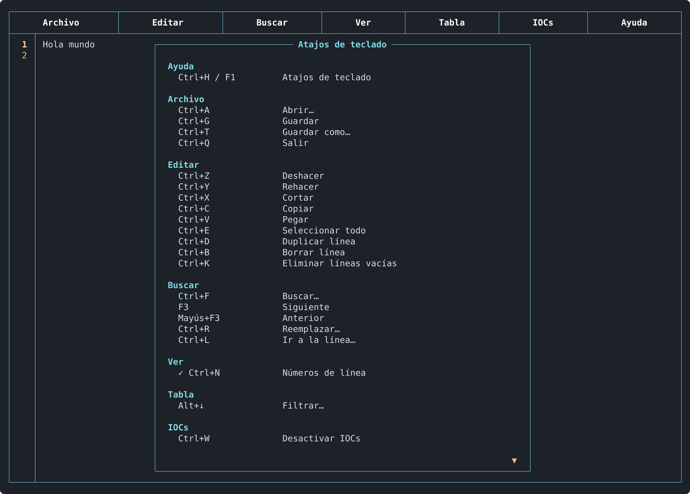
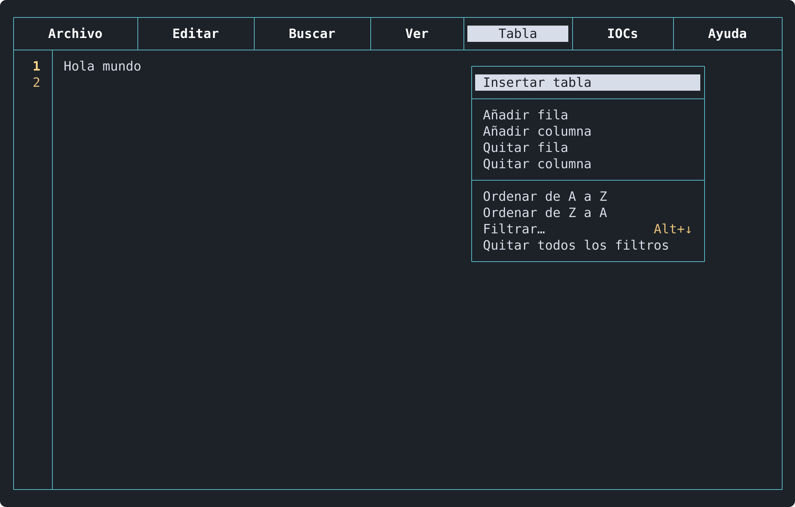
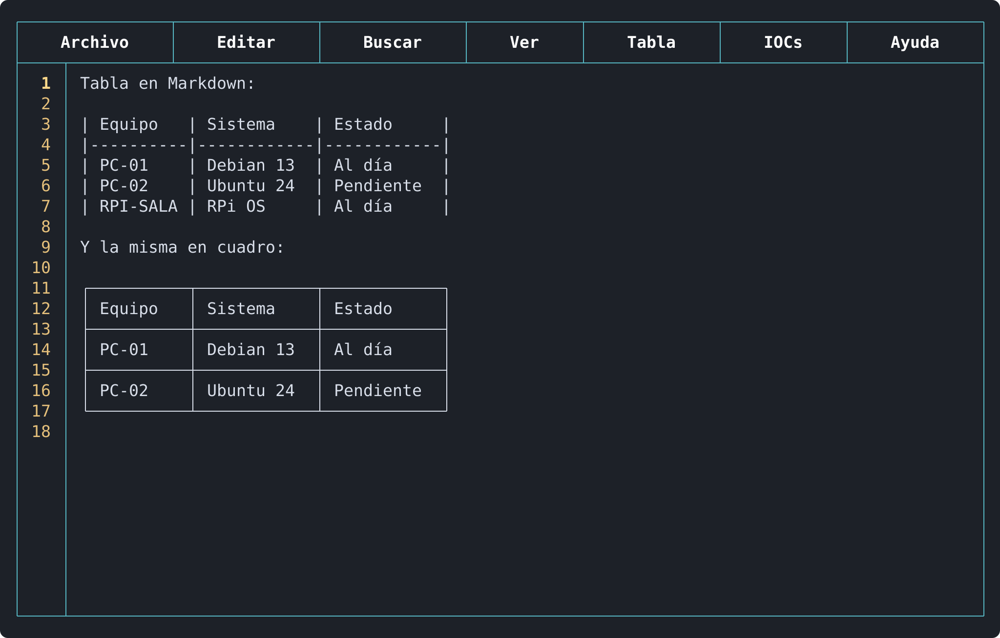
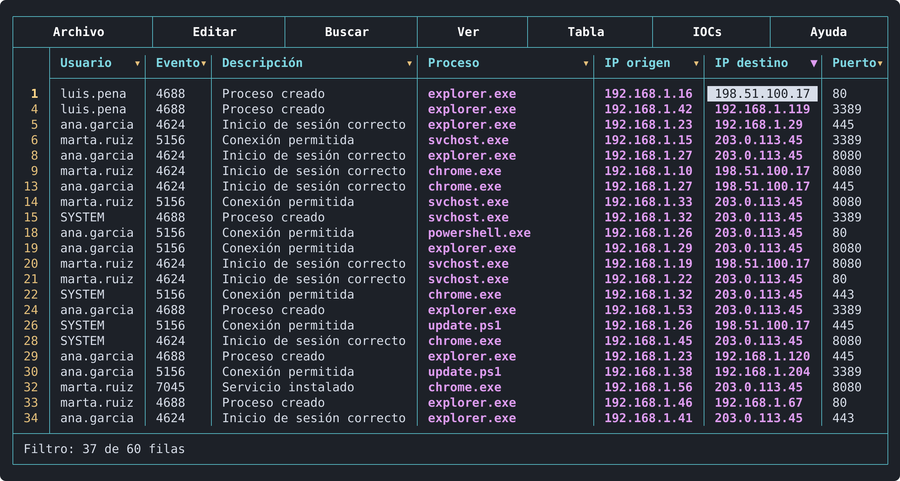
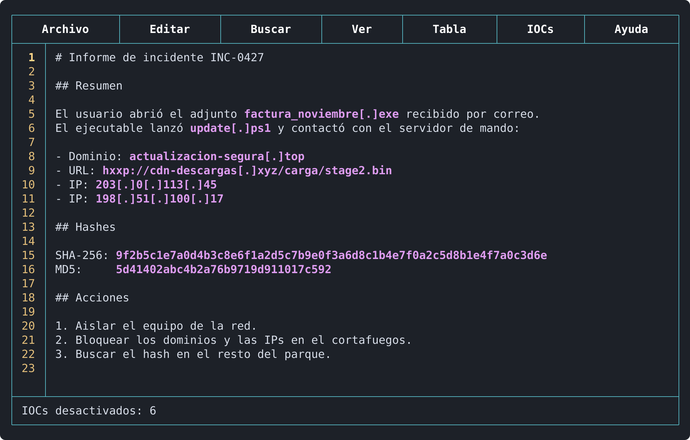
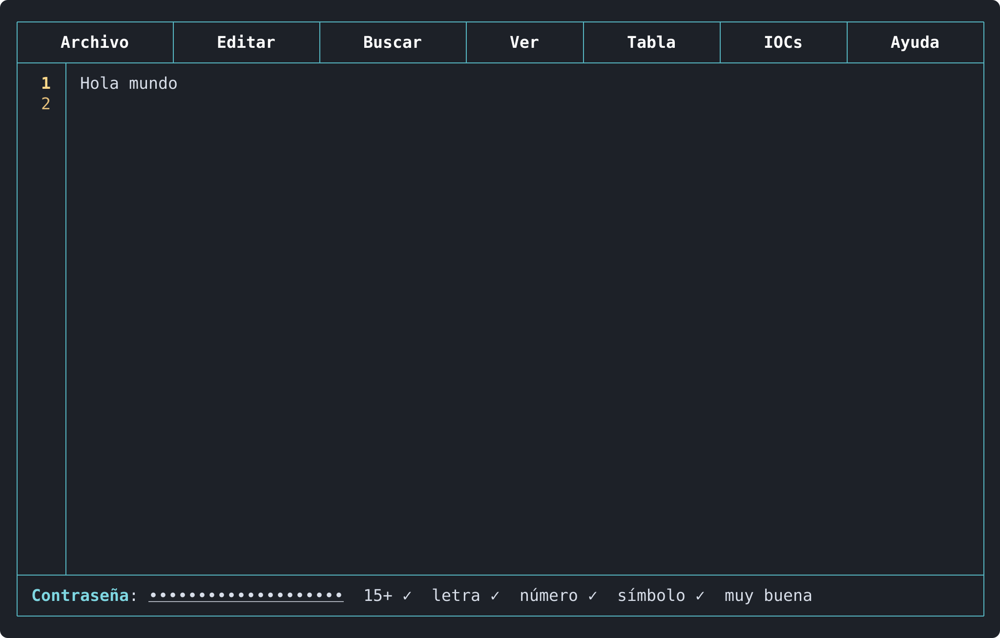

# isi

[English](README.en.md)

Editor de texto para la terminal: rápido, sencillo y en 23
idiomas.



- Menús desplegables con ratón o con el tabulador, y atajos de teclado
  para todo.
- Números de línea que se quitan y se ponen con Ctrl+N.
- Tablas en Markdown o en cuadro que se ajustan solas mientras escribes.
- Abre los CSV como una hoja de cálculo: ordena y filtra por columna como
  en Excel, cuenta cuántas veces sale cada valor y entiende IPs, rangos de
  red y fechas. Pensado para timelines y salidas de herramientas forenses
  de cientos de miles de filas.
- Resalta y desactiva IOCs (dominios, IPs, URLs, ejecutables y hashes):
  `evil.com` pasa a `evil[.]com` con una tecla, o mientras escribes.
- Cifrado de ficheros con XChaCha20-Poly1305 y Argon2id.
- En 23 idiomas. Arranca en el idioma del sistema o, si no lo tiene, en
  español.
- Guardar como con un explorador de carpetas.
- UTF-8 completo: ñ, tildes, ¿¡, €, chino, emojis...
- Un solo binario estático, sin dependencias. Abre un fichero de un
  millón de líneas en menos de medio segundo.

## Instalar

Descarga el `.deb` de tu equipo desde la página de
[versiones](https://github.com/zil00g/isi/releases):

| Paquete | Para |
|---|---|
| `isi_1.0.3_amd64.deb` | PC y portátiles de 64 bits |
| `isi_1.0.3_i386.deb` | PC antiguos de 32 bits |
| `isi_1.0.3_arm64.deb` | Raspberry Pi 3, 4 y 5 con sistema de 64 bits |
| `isi_1.0.3_armhf.deb` | Raspberry Pi con Raspberry Pi OS de 32 bits |

y, en la carpeta donde lo hayas descargado:

```sh
sudo apt install ./isi_1.0.3_amd64.deb
```

También vale `sudo dpkg -i isi_1.0.3_amd64.deb`.

En la página de cada versión están las sumas SHA-256 de todos los
ficheros. Para comprobar que el que has bajado está bien, descarga
también `SHA256SUMS` y en la misma carpeta:

```sh
sha256sum -c SHA256SUMS --ignore-missing
```

Es un binario estático: no usa las bibliotecas del sistema, así que no
depende de su versión. Para otras distribuciones están los `.tar.gz` con
el binario suelto.

Para desinstalarlo: `sudo apt remove isi`.

### Desde el código

Hace falta un compilador de C y `make`:

```sh
make
make check
sudo make install
```

`make check` comprueba los IOCs, el CSV, los filtros y el cifrado, y que
los ficheros cifrados con versiones anteriores se siguen abriendo.

`make estatico` lo compila estático y `make deb` genera el paquete en
`dist/`. Con musl (`CC=musl-gcc`) sale bastante más pequeño que con glibc.
`make MONOCYPHER=sistema` usa la biblioteca Monocypher instalada en el
sistema (la busca con `pkg-config`) en vez de la copia de `monocypher/`.

El binario se compila con protector de pila, `_FORTIFY_SOURCE`, PIE y
RELRO completo. Al instalar el paquete, isi queda disponible como
alternativa de `editor` (con prioridad baja, así que no cambia el que ya
tengas): `sudo update-alternatives --config editor` para elegirlo.

## Uso

```sh
isi fichero.txt
isi -r /etc/fstab    # solo lectura
isi +120 informe.txt # empieza en la línea 120
isi informe.txt:120  # lo mismo, tal cual lo da grep -n
```



Ctrl+H (o F1) enseña todos los atajos y F10 abre los menús. Los más usados:

| Tecla | Hace |
|---|---|
| Ctrl+G / Ctrl+T | Guardar / guardar como |
| Ctrl+A | Abrir |
| Ctrl+Q | Salir |
| Ctrl+Z / Ctrl+Y | Deshacer / rehacer |
| Ctrl+X / C / V | Cortar / copiar / pegar |
| Ctrl+E | Seleccionar todo |
| Ctrl+F, F3 | Buscar, siguiente |
| Ctrl+R | Reemplazar |
| Ctrl+L | Ir a una línea |
| Ctrl+N | Números de línea |
| Ctrl+D / Ctrl+B | Duplicar / borrar línea |
| Ctrl+K | Eliminar líneas vacías |
| Inicio / Fin | Principio / final del texto |
| Alt+Inicio / Alt+Fin | Principio / final de la línea |

Los avisos salen en una fila abajo que desaparece sola al minuto, con
doble clic o con Esc.

Si mientras lo tienes abierto alguien cambia el fichero, otro programa o
un compañero por SSH, al guardar isi te pregunta antes de pisarlo.

### Buscar con expresiones regulares

En Ctrl+F y Ctrl+R puedes usar expresiones regulares. Las pones entre
barras y tienen que llevar alguno de estos caracteres:
`[ ] ( ) * + ? { } | ^ $ \`. No distingue mayúsculas. Unos ejemplos:

```
/[0-9a-f]{64}/                    hashes SHA-256
/([0-9]{1,3}\.){3}[0-9]{1,3}/     direcciones IPv4
/^2026-11-0[1-7]/                 líneas de la primera semana
```

Si no lleva ninguno de esos caracteres se busca tal cual, como siempre.
Así una ruta como `/tmp/` o `/home/ana/.config/` se busca y se reemplaza
como texto normal.

### Copiar y pegar

Para pegar en isi algo copiado fuera (una web, un documento, otra
terminal) usa **Ctrl+Mayús+V**, el pegado de la terminal. Funciona en
cualquier Linux sin instalar nada. Ctrl+V a secas pega lo último que
copiaste dentro de isi.

Al copiar con Ctrl+C, isi manda el texto a la terminal (OSC 52), así que
en kitty, foot, WezTerm, Alacritty, xterm, tmux y por SSH llega al
portapapeles del sistema sin instalar nada. Si además tienes `wl-copy`,
`xclip` o `xsel`, también los usa.

Algunas terminales, como GNOME Terminal, no admiten OSC 52. En ellas
hace falta `wl-clipboard` (o `xclip` en X11) para pegar fuera de isi lo
que copias con Ctrl+C:

```sh
sudo apt install wl-clipboard
```

## Tablas

Menú Tabla, Insertar tabla. Se eligen las columnas, las filas y el
estilo:



Tab y Mayús+Tab saltan de celda y Enter va a la primera celda de la fila siguiente, o la
crea si estás en la última. Al escribir, la columna crece y el resto de
la tabla se recoloca. Desde el mismo menú se añaden y quitan filas y
columnas.

## CSV

Un `.csv` o un `.tsv` no se abre como texto: se abre como una hoja, con
las columnas alineadas, los títulos fijos arriba aunque bajes y la
columna que no cabe se ve moviéndote a los lados. Si el fichero tiene
otra extensión, Archivo, Abrir CSV.


Se edita celda a celda: escribes y ya está, Tab y Mayús+Tab pasan de
celda, Enter baja a la fila de abajo, y en la última fila Enter o Tab
crean una nueva. Ctrl+D duplica la fila, Ctrl+B la borra y desde el menú
Tabla se añaden y quitan filas y columnas. Ctrl+C copia la celda.

Al guardar, el fichero queda exactamente igual que estaba salvo lo que
hayas cambiado: mismo separador, mismas comillas, mismos saltos de línea
(también los de Windows) y las celdas que no tocas no cambian ni un
byte. Si una celda tiene el separador, comillas o saltos de línea, isi
pone las comillas que hagan falta.

### Ordenar

Alt+↓ en cualquier celda (o clic en la flechita del título) abre el menú
de la columna. Ordenar de A a Z o de Z a A mueve las filas enteras, con
Ctrl+Z lo deshaces de golpe, y ordena según lo que hay en la columna:

- Números como números: `9` antes que `10`, y `1.204,75 €` es un número.
- IPs por su valor: `10.0.0.9`, `10.0.0.10`, `10.0.0.100`.
- Fechas por orden real, aunque estén mezcladas: `2026-11-03T10:15:22.123Z`,
  `2026-11-03 10:15` y `17/11/2026 09:00` se ordenan juntas.
- Texto en orden de diccionario: sin mirar mayúsculas ni tildes, y la ñ
  después de la n.
- Las celdas vacías siempre al final.

### Filtrar

En el mismo menú está la lista de todos los valores de la columna, cada
uno con las veces que aparece, y casillas para quedarte con los que
quieras (Espacio marca y desmarca, Enter aplica). La lista se puede
ordenar por valor o por frecuencia: con "los menos frecuentes primero"
lo raro sale arriba, que es lo que se busca al apilar una timeline.


Y si escribes, la lista se filtra mientras escribes:


| Escribes | Se queda con |
|---|---|
| `madr` | lo que contiene "madr", sin mirar mayúsculas ni tildes |
| `Madr*` | lo que empieza por Madr (Madrid, Madrileños) |
| `*rid` | lo que termina en rid |
| `Madri?` | Madri y un carácter más |
| `192.168.1.0/24` | las IPs de esa red |
| `!10.0.0.0/8` | todo menos esa red |
| `>1000`, `<=50`, `=443` | comparaciones con números, IPs o fechas |
| `2026-03-01..2026-03-31` | un rango, aquí todo marzo (el último día entero) |
| `>=2026-11-03` | desde ese día |
| `svchost \| explorer` | una cosa o la otra |

Se pueden filtrar varias columnas a la vez. Las columnas filtradas
llevan `▼` en el título, abajo se ve cuántas filas quedan y las filas
mantienen su número, como en Excel. Tabla, Quitar todos los filtros, lo
deja como estaba. Buscar con Ctrl+F se salta las filas que no se ven.



Los IOCs se resaltan también dentro de las celdas y Ctrl+W los desactiva
en todo el fichero.

### Convertir en tabla

Archivo, Convertir CSV en tabla. Con un CSV abierto, crea un documento
nuevo con la tabla en Markdown o en cuadro, con lo que estás viendo: si
tienes un filtro puesto, solo esas filas, y en el orden que tengas. Sin
un CSV abierto, te deja elegir el fichero y mete la tabla donde está el
cursor; en ese caso convierte a UTF-8 los CSV que guarda Excel en
Latin-1.

### Ficheros grandes

Probado con una timeline de 200.000 filas, 12 columnas y 46 MB en un
portátil normal: se abre en menos de un segundo, ordenar por IP tarda
un segundo y medio y escribir en una celda va igual de fluido que en un
fichero pequeño.

## IOCs

El menú IOCs está pensado para quien trabaja con informes de incidentes o
muestras de malware:


- Resalta dominios, IPs, URLs, ejecutables (`.exe`, `.dll`, `.ps1`,
  `.vbs`, `.hta`, `.lnk`, `.scr`...) y hashes MD5, SHA-1 y SHA-256,
  también dentro de código. Distingue `evil.com` de `this.top` o
  `logger.info()`.
- Desactivar IOCs (Ctrl+W): `evil.com` → `evil[.]com`,
  `http://` → `hxxp://`, `1.2.3.4` → `1[.]2[.]3[.]4`. Sobre la selección
  o sobre todo el texto.

  

- Reactivar IOCs hace lo contrario y entiende también `(.)` y `[dot]`.
- Desactivar al escribir: cada IOC se desactiva en cuanto terminas de
  escribirlo o lo pegas.
- Copiar lista de IOCs: al portapapeles, sin repetidos y desactivados.

## Idiomas

Español, English (US), English (UK), 中文, हिन्दी, العربية, Français,
Português, Русский, Bahasa Indonesia, Deutsch, 日本語, Türkçe, Tiếng Việt,
한국어, Italiano, ไทย, Polski, Українська, Nederlands, Ελληνικά, עברית y
Hrvatski. Se cambia en Ver, Idioma, y se recuerda en
`~/.config/isi/config`.

## Cifrado

Archivo, Cifrar. Pide una contraseña de 15 caracteres como mínimo con
letras, números y algún símbolo, y la pide dos veces.



Desde ese momento cada vez que guardes se guarda cifrado. Al abrirlo con isi pide la
contraseña.

Si la olvidas no hay manera de recuperar el fichero. Ni yo ni nadie.

Formato del fichero, por si quieres descifrarlo con otra herramienta:

| Bytes | Contenido |
|---|---|
| 0-3 | `ISI1` |
| 4-19 | Sal de Argon2id |
| 20-43 | Nonce de XChaCha20 |
| 44-59 | Etiqueta Poly1305 |
| 60- | Texto cifrado |

La clave sale de Argon2id con 64 MiB de memoria, 3 pasadas y un solo
hilo. Los 44 primeros bytes van como datos asociados, así que si alguien
toca la cabecera el fichero no se abre. Cada guardado usa un nonce nuevo.

En [FORMATO.md](FORMATO.md) está con más detalle y con un script de
Python para abrirlo sin isi. Lo que protege y lo que no, y cómo avisarme
de un fallo de seguridad, en [SECURITY.md](SECURITY.md).

## Licencia

GPL versión 3 o posterior. Ver [LICENSE](LICENSE).

El cifrado es [Monocypher](https://monocypher.org), de Loup Vaillant y
otros, con licencia BSD de dos cláusulas o CC0, incluido sin cambios en
`monocypher/`.
