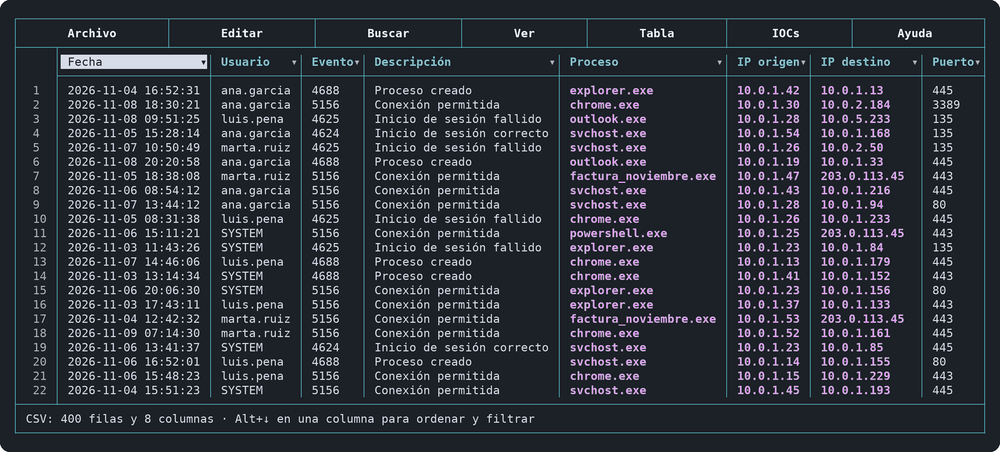
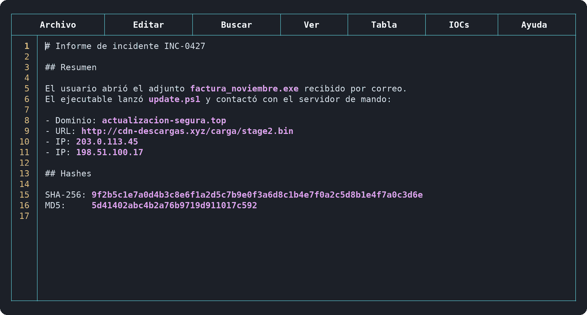
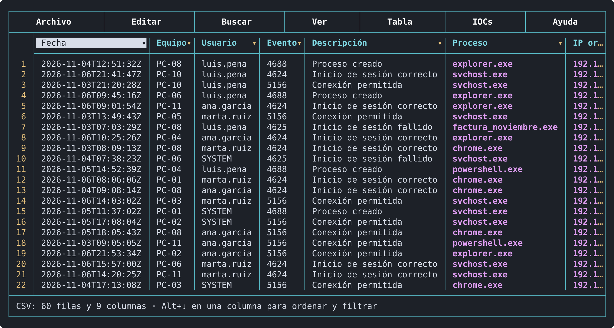
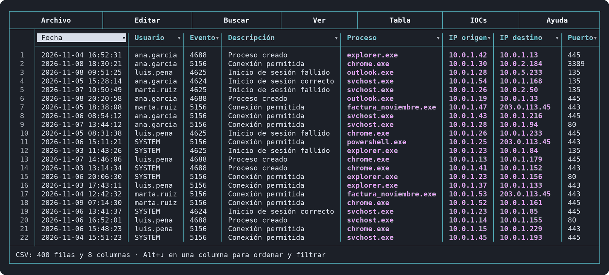
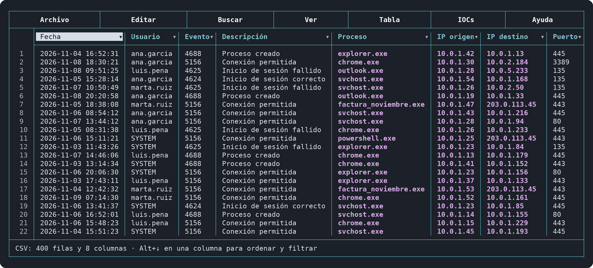
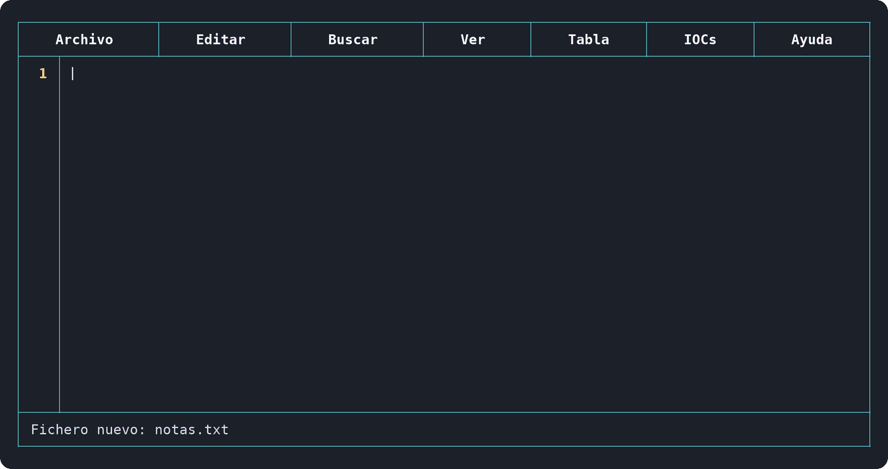
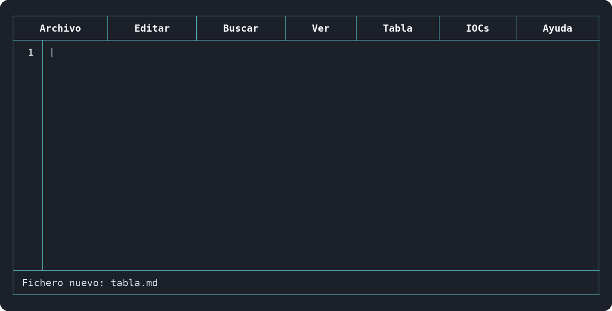
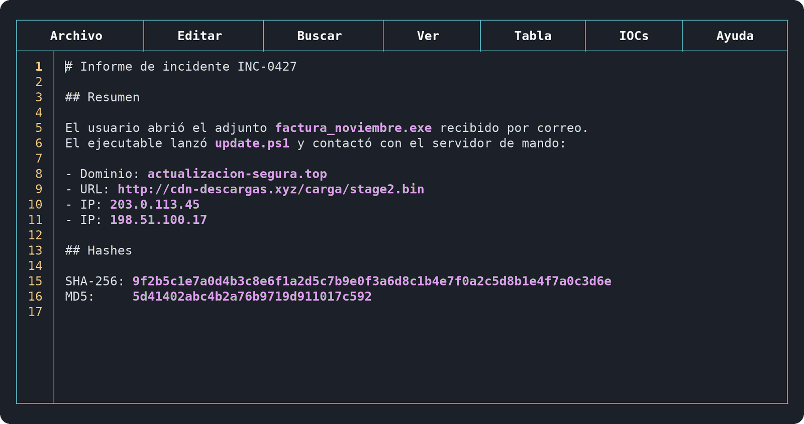
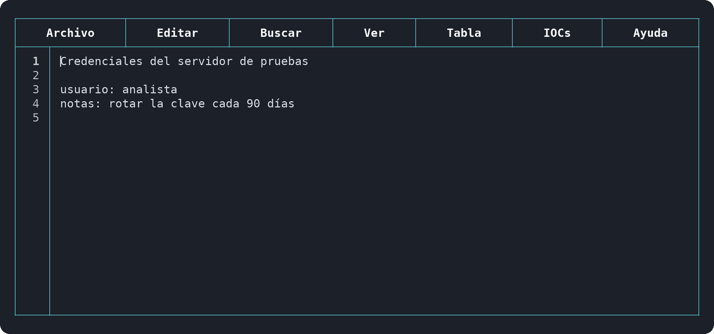
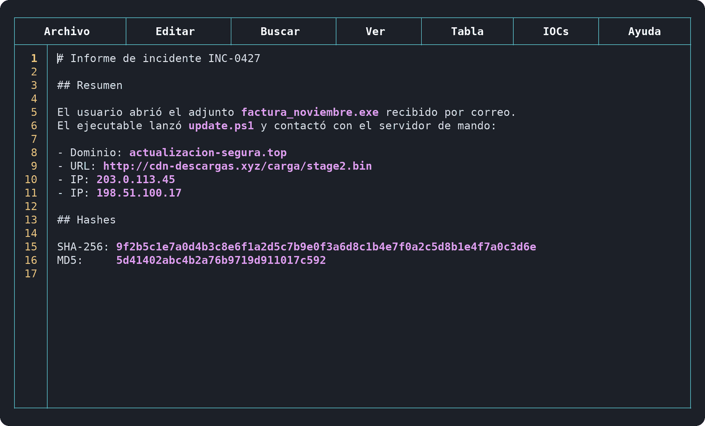

<div align="center">

# isi

[](https://github.com/zil00g/isi/actions/workflows/revisar.yml)
[](https://github.com/zil00g/isi/releases/latest)
[](LICENSE)

[English](README.en.md)

</div>

Editor de texto para la terminal pensado para quien trabaja en ciberseguridad. Abre los CSV como una hoja de cálculo, desactiva IOCs con una tecla y cifra los ficheros. Es un solo binario y no necesita nada más.



La idea viene del trabajo diario en un CSIRT. Para revisar una timeline o preparar un informe se acaba saltando entre un editor, una hoja de cálculo y scripts sueltos para desactivar los IOCs. isi junta todo eso en un solo programa que corre en cualquier terminal.

Los ficheros de texto y los CSV se manejan de forma sencilla, con atajos de teclado o desde los menús, usando el ratón o el tabulador.

Está escrito en C y con un par de años a sus espaldas se fue transformando en una herramienta con buen rendimiento, pensada para ahorrar tiempo en las fases de investigación de un incidente y tratar distintos ficheros de forma ágil y sencilla. Le fui añadiendo las funciones que me eran útiles, por ejemplo filtrar un CSV de cientos de miles de filas antes de abrirlo en una hoja de cálculo, para que no se quede colgada. Durante ese tiempo fue un proyecto personal, uno de tantos que tengo, hasta que en noviembre de 2026 decidí publicarlo para compartirlo.

## Índice

- [Instalación](#instalación)
- [Primeros pasos](#primeros-pasos)
- [Trabajar con un CSV](#trabajar-con-un-csv)
- [IOCs](#iocs)
- [Tablas](#tablas)
- [Buscar y reemplazar](#buscar-y-reemplazar)
- [Copiar y pegar](#copiar-y-pegar)
- [Cifrado](#cifrado)
- [Idioma](#idioma)
- [Compilar desde el código](#compilar-desde-el-código)
- [Incidencias y mejoras](#incidencias-y-mejoras)
- [Licencia](#licencia)

## Instalación

Se descarga el `.deb` correspondiente al equipo desde la página de [versiones](https://github.com/zil00g/isi/releases):

| Paquete | Para |
|---|---|
| `isi_1.0.4_amd64.deb` | PC y portátiles de 64 bits |
| `isi_1.0.4_i386.deb` | PC antiguos de 32 bits |
| `isi_1.0.4_arm64.deb` | Raspberry Pi 3, 4 y 5 con sistema de 64 bits |
| `isi_1.0.4_armhf.deb` | Raspberry Pi con Raspberry Pi OS de 32 bits |

Desde la carpeta de descarga se ejecuta:

```sh
sudo apt install ./isi_1.0.4_amd64.deb
```

También vale `sudo dpkg -i isi_1.0.4_amd64.deb`. Para desinstalarlo se usa `sudo apt remove isi`.

En la página de cada versión están las sumas SHA-256 de todos los ficheros. Para comprobar que la descarga está bien se baja también `SHA256SUMS` y en la misma carpeta se ejecuta:

```sh
sha256sum -c SHA256SUMS --ignore-missing
```

Es un binario estático, no usa las bibliotecas del sistema y por eso no depende de su versión. Para otras distribuciones están los `.tar.gz` con el binario suelto.

Al instalar el paquete, isi queda disponible como alternativa de `editor` con prioridad baja, así que no cambia el que ya se tenga. Para elegirlo se usa `sudo update-alternatives --config editor`.

## Primeros pasos

Para abrir un fichero se ejecuta desde la terminal:

```sh
isi informe.txt
isi -r /etc/fstab        # solo lectura
isi +120 informe.txt     # abre en la línea 120
isi informe.txt:120      # lo mismo, tal cual lo da grep -n
```

Todo se puede hacer con atajos de teclado o desde los menús. Con F10 o con el ratón se abren los menús Archivo, Editar, Buscar, Ver, Tabla, IOCs y Ayuda, y con Ctrl+H o F1 se muestran todos los atajos.



Los atajos más usados son estos:

| Tecla | Hace |
|---|---|
| Ctrl+G / Ctrl+T | Guardar / guardar como |
| Ctrl+A | Abrir |
| Ctrl+Q | Salir |
| Ctrl+Z / Ctrl+Y | Deshacer / rehacer |
| Ctrl+X / C / V | Cortar / copiar / pegar |
| Ctrl+E | Seleccionar todo |
| Ctrl+F, F3 | Buscar, siguiente |
| Ctrl+R | Reemplazar |
| Ctrl+L | Ir a una línea |
| Ctrl+N | Números de línea |
| Ctrl+D / Ctrl+B | Duplicar / borrar línea |
| Ctrl+K | Eliminar líneas vacías |
| Inicio / Fin | Principio / final del texto |
| Alt+Inicio / Alt+Fin | Principio / final de la línea |

Guardar como abre un explorador de carpetas para elegir dónde se guarda el fichero.

Los avisos salen en una fila abajo que desaparece sola al minuto, con doble clic o con Esc.

Si mientras el fichero está abierto otro programa o un compañero por SSH lo cambia, al guardar isi pregunta antes de pisarlo. Al guardar, isi escribe primero en un fichero temporal y después lo cambia por el original, así un fallo a mitad no deja el fichero roto.

isi maneja UTF-8 completo: ñ, tildes, ¿¡, €, chino, emojis... Y va rápido, un fichero de un millón de líneas se abre en menos de medio segundo.

## Trabajar con un CSV

En una investigación es normal tener que revisar timelines o salidas de herramientas forenses con cientos de miles de filas. Al abrirlas en una hoja de cálculo el programa suele tardar mucho en cargar, se queda colgado o directamente no las abre enteras. Excel y LibreOffice Calc no pasan de 1.048.576 filas, y lo que sobra se queda fuera sin que muchas veces uno se dé cuenta.

En isi esto no sucede. Se ha probado con una timeline de 200.000 filas, 12 columnas y 46 MB en un portátil normal. Se abre en menos de un segundo, ordenar por IP tarda un segundo y medio y escribir en una celda va igual de fluido que en un fichero pequeño.

Un fichero `.csv` o `.tsv` se abre directamente como una hoja de cálculo, con las columnas alineadas y los títulos fijos arriba aunque se baje. La columna que no cabe se ve moviéndose a los lados. Si el fichero tiene otra extensión se abre desde Archivo, Abrir CSV.



Se edita celda a celda. Se escribe y ya está, Tab y Mayús+Tab pasan de celda, Enter baja a la fila de abajo y en la última fila Enter o Tab crean una nueva. Ctrl+D duplica la fila, Ctrl+B la borra y desde el menú Tabla se añaden y quitan filas y columnas. Ctrl+C copia la celda.

Al guardar, el fichero queda exactamente igual que estaba salvo lo que se haya cambiado. Se mantienen el separador, las comillas y los saltos de línea, también los de Windows, y las celdas que no se tocan no cambian ni un byte. Si una celda lleva el separador, comillas o saltos de línea, isi pone las comillas que hagan falta.

### Ordenar

Con Alt+↓ sobre cualquier columna, o con un clic en la flechita del título, se abre su menú y desde él se ordena de A a Z o de Z a A. Se mueven las filas enteras y con Ctrl+Z se deshace de golpe.

isi reconoce lo que hay en la columna y lo ordena correctamente. Los números van como números, `9` antes que `10`, y `1.204,75 €` también cuenta como número. Las IPs van por su valor, `10.0.0.9`, `10.0.0.10`, `10.0.0.100`. Las fechas van por orden real aunque vengan en formatos distintos, `2026-11-03T10:15:22.123Z`, `2026-11-03 10:15` y `17/11/2026 09:00` se ordenan juntas. El texto va en orden de diccionario, sin mirar mayúsculas ni tildes y con la ñ después de la n. Las celdas vacías quedan siempre al final.



### Apilar y filtrar

En el mismo menú aparece la lista de valores de la columna con las veces que se repite cada uno. Si se ordena por los menos frecuentes primero, lo raro sale arriba, que es justo lo que se busca al apilar una timeline. Cada valor tiene su casilla, Espacio la marca o la desmarca y Enter aplica el filtro.


Para filtrar basta con escribir en esa lista, y se va filtrando mientras se escribe:

| Se escribe | Se queda con |
|---|---|
| `madr` | lo que contiene "madr", sin mirar mayúsculas ni tildes |
| `Madr*` | lo que empieza por Madr, como Madrid o Madrileños |
| `*rid` | lo que termina en rid |
| `Madri?` | Madri y un carácter más |
| `192.168.1.0/24` | las IPs de esa red |
| `!10.0.0.0/8` | todo menos esa red |
| `>1000`, `<=50`, `=443` | comparaciones con números, IPs o fechas |
| `2026-03-01..2026-03-31` | un rango, aquí todo marzo con el último día entero |
| `>=2026-11-03` | desde ese día |
| `svchost \| explorer` | una cosa o la otra |

Se pueden filtrar varias columnas a la vez. Las columnas filtradas llevan `▼` en el título, abajo se ve cuántas filas quedan y las filas mantienen su número, como en Excel. Desde Tabla, Quitar todos los filtros, se deja como estaba. Buscar con Ctrl+F se salta las filas que no se ven.

Los IOCs se resaltan también dentro de las celdas y Ctrl+W los desactiva en todo el fichero.

### Convertir en tabla

Con el filtro puesto, desde Archivo, Convertir CSV en tabla, se obtiene un documento nuevo con la tabla en Markdown o en cuadro, solo con las filas filtradas y en el orden que se tenga. De este modo un CSV de cientos de miles de filas se queda en lo necesario antes de pasarlo a una hoja de cálculo o a un informe.



Sin un CSV abierto, la misma opción deja elegir el fichero y mete la tabla donde está el cursor. En ese caso los CSV que guarda Excel en Latin-1 se convierten a UTF-8.

## IOCs

El menú IOCs está pensado para quien trabaja con informes de incidentes o muestras de malware.

isi resalta dominios, IPs, URLs, ejecutables como `.exe`, `.dll`, `.ps1`, `.vbs`, `.hta`, `.lnk` o `.scr`, y hashes MD5, SHA-1 y SHA-256, también dentro de código. Distingue `evil.com` de `this.top` o de `logger.info()`.

Con Ctrl+W se desactivan en la selección o en todo el texto. `evil.com` pasa a `evil[.]com`, `http://` a `hxxp://` y `1.2.3.4` a `1[.]2[.]3[.]4`.



Desde el menú IOCs también se puede:

- Desactivar al escribir, para que cada IOC se desactive en cuanto se termina de escribir o se pega.
- Reactivar IOCs, que hace lo contrario y entiende también `(.)` y `[dot]`.
- Copiar lista de IOCs, que los copia al portapapeles sin repetidos y desactivados, listos para el informe.

## Tablas

Desde Tabla, Insertar tabla, se eligen las columnas, las filas y el estilo, Markdown o cuadro.



Tab y Mayús+Tab saltan de celda y Enter va a la primera celda de la fila siguiente, o la crea si se está en la última. Al escribir, la columna crece y el resto de la tabla se recoloca sola. Desde el mismo menú se añaden y quitan filas y columnas.

## Buscar y reemplazar

Ctrl+F busca, F3 va al siguiente y Mayús+F3 al anterior. Ctrl+R reemplaza.

En los dos se pueden usar expresiones regulares. Se ponen entre barras y tienen que llevar alguno de estos caracteres: `[ ] ( ) * + ? { } | ^ $ \`. No distinguen mayúsculas. Unos ejemplos:

```
/[0-9a-f]{64}/                    hashes SHA-256
/([0-9]{1,3}\.){3}[0-9]{1,3}/     direcciones IPv4
/^2026-11-0[1-7]/                 líneas de la primera semana
```



Si entre las barras no hay ninguno de esos caracteres se busca el texto tal cual. Así una ruta como `/tmp/` o `/home/ana/.config/` se busca y se reemplaza como texto normal.

## Copiar y pegar

Para pegar en isi algo copiado fuera, de una web, un documento u otra terminal, se usa Ctrl+Mayús+V, que es el pegado de la terminal. Funciona en cualquier Linux sin instalar nada. Ctrl+V a secas pega lo último que se copió dentro de isi.

Al copiar con Ctrl+C, isi manda el texto a la terminal con OSC 52, así que en kitty, foot, WezTerm, Alacritty, xterm, tmux y por SSH llega al portapapeles del sistema sin instalar nada. Si además están `wl-copy`, `xclip` o `xsel`, también los usa.

Algunas terminales, como GNOME Terminal, no admiten OSC 52. En ellas hace falta `wl-clipboard`, o `xclip` en X11, para pegar fuera de isi lo que se copia con Ctrl+C:

```sh
sudo apt install wl-clipboard
```

## Cifrado

Desde Archivo, Cifrar, se introduce dos veces una contraseña de 15 caracteres como mínimo con letras, números y algún símbolo. Mientras se escribe, isi indica qué le falta y cómo de buena es. A partir de ese momento el fichero se guarda siempre cifrado y al abrirlo isi pide la contraseña.



Si se olvida la contraseña no hay manera de recuperar el fichero.

Si un fichero cifrado se guarda con otro nombre, isi vuelve a pedir la contraseña y genera una sal nueva, así la copia no deja ver que las dos usan la misma contraseña. Para dejar de cifrarlo se usa Archivo, Quitar cifrado.

El cifrado usa XChaCha20-Poly1305 y la clave sale de Argon2id con 64 MiB de memoria, 3 pasadas y un solo hilo. El formato del fichero es este:

| Bytes | Contenido |
|---|---|
| 0-3 | `ISI1` |
| 4-19 | Sal de Argon2id |
| 20-43 | Nonce de XChaCha20 |
| 44-59 | Etiqueta Poly1305 |
| 60- | Texto cifrado |

Los 44 primeros bytes van como datos asociados, así que si alguien toca la cabecera el fichero no se abre. Cada guardado usa un nonce nuevo.

En [FORMATO.md](FORMATO.md) está con más detalle y con un script de Python para abrirlo sin isi. Lo que protege y lo que no está en [SECURITY.md](SECURITY.md).

## Idioma

Cuando se pasan muchas horas delante de la computadora, trabajar en el idioma materno se agradece. Por eso, al pensar en compartir este proyecto, me molesté en buscar traducciones a los idiomas de personas de distintos puntos del mundo.

isi arranca en el idioma del sistema y, si no lo tiene, en español. Para cambiarlo se accede a Ver, Idioma, y se elige uno de los 23 disponibles. La elección se guarda en `~/.config/isi/config`.



Si el tuyo no está y te gustaría verlo en tu idioma, puedes proponerlo abriendo una [issue](https://github.com/zil00g/isi/issues). No tendré problema en dejarlo en la lista de mejoras para las siguientes versiones.

## Compilar desde el código

Hace falta un compilador de C y `make`:

```sh
make
make check
sudo make install
```

`make check` comprueba los IOCs, el CSV, los filtros y el cifrado, y que los ficheros cifrados con versiones anteriores se siguen abriendo.

`make estatico` lo compila estático y `make deb` genera el paquete en `dist/`. Con musl, `CC=musl-gcc`, sale bastante más pequeño que con glibc. `make MONOCYPHER=sistema` usa la biblioteca Monocypher instalada en el sistema, que busca con `pkg-config`, en vez de la copia de `monocypher/`.

El binario se compila con protector de pila, `_FORTIFY_SOURCE`, PIE y RELRO completo.

## Incidencias y mejoras

Los fallos y las propuestas de mejora se gestionan mediante las [issues](https://github.com/zil00g/isi/issues) del repositorio. Para reportar un fallo se debe indicar la versión de isi (`isi -v`), la distribución, la terminal utilizada y los pasos necesarios para reproducirlo. Los fallos se tratan con prioridad y se corrigen a la mayor brevedad posible. Las propuestas de mejora se estudian y, si encajan en el proyecto, se incluyen en la planificación de las siguientes versiones.

Los fallos de seguridad no se deben publicar en una issue. El procedimiento para comunicarlos está en [SECURITY.md](SECURITY.md).

## Licencia

GPL versión 3 o posterior. Ver [LICENSE](LICENSE).

El cifrado es [Monocypher](https://monocypher.org), de Loup Vaillant y otros, con licencia BSD de dos cláusulas o CC0, incluido sin cambios en `monocypher/`.
